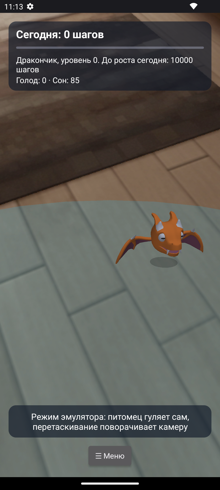
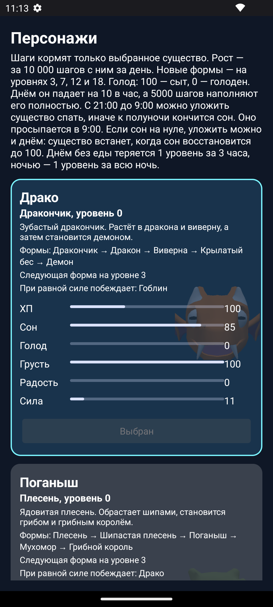
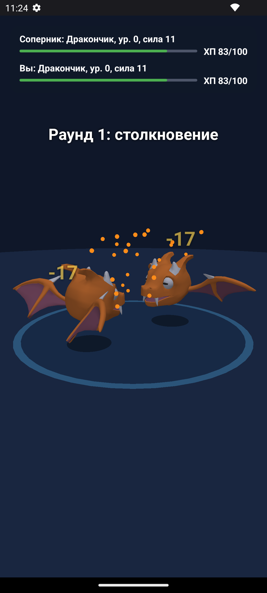
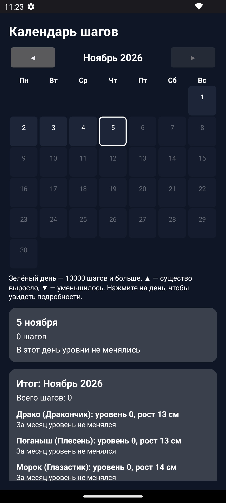

# Шагомонстры

Мобильная игра под Android, в которой виртуальный монстр растёт и эволюционирует **от ваших реальных шагов** — и в режиме дополненной реальности ходит рядом с вами по полу через камеру.

Шаги из датчика телефона кормят выбранное существо, оно набирает уровни и меняет формы, за ним нужно ухаживать (голод, сон), а ещё можно сражаться с питомцами друзей рядом и играть в AR-мини-игру.

## Возможности

- **AR-питомец** — 3D-существо ходит по реальному полу (ARCore + OpenGL ES). На устройствах без ARCore есть запасной режим поверх камеры.
- **Рост от шагов** — 10 000 шагов за день дают уровень; новые формы на уровнях 3, 7, 12 и 18.
- **4 вида × 5 форм** — Драко, Поганыш, Морок и Гоблин, у каждого своя цепочка эволюции.
- **Уход** — голод и сон: существо нужно кормить шагами и вовремя укладывать спать, иначе оно слабеет и теряет уровень.
- **Бой с игроком рядом** — PvP по Bluetooth/Wi-Fi (Nearby Connections), без интернета и серверов.
- **Мини-игра** — AR-защита кристалла от дронов.
- **Календарь шагов** — история по дням с ростом и спадом существ.
- **Офлайн и приватность** — весь прогресс хранится только на телефоне, без аккаунтов.

## Скриншоты

| AR-питомец | Персонажи | Бой | Календарь |
|:---:|:---:|:---:|:---:|
|  |  |  |  |

## Установка готового APK

Скачайте **[`Shagomonstry-v1.0.apk`](Shagomonstry-v1.0.apk)** из корня репозитория (или из раздела Releases) и установите на Android-устройство (нужно разрешить установку из неизвестных источников). Для полноценного AR нужен телефон с поддержкой ARCore.

## Сборка из исходников

Требуется JDK 17+ и Android SDK (можно просто открыть проект в Android Studio).

```bash
./gradlew assembleDebug
```

Готовый APK появится в `app/build/outputs/apk/debug/app-debug.apk`.

## Технологии

- **Язык:** Kotlin
- **Платформа:** Android, minSdk 26 (Android 8.0), targetSdk 37
- **Графика:** собственный парсер GLB, скелетная анимация и рендер на OpenGL ES 3.0
- **AR:** Google ARCore
- **Мультиплеер:** Google Nearby Connections

## Лицензии и ассеты

3D-модели существ — из набора **Quaternius «Ultimate Monsters»** (лицензия **CC0**, public domain). Исходный пак не включён в репозиторий; в сборке используются только нужные модели в `app/src/main/assets/models/`.

## Структура проекта

```
app/src/main/java/com/kocti/crystaldefense/
├── PetActivity.kt          — главный экран (AR-питомец)
├── CharactersActivity.kt   — персонажи и выбор существа
├── HistoryActivity.kt      — календарь шагов
├── BattleActivity.kt       — бой с игроком рядом
├── pet/                    — логика питомца, шаги, вайталы, сон
│   ├── glb/                — парсер GLB, скелетная анимация, рендер
│   └── battle/             — правила и сцена боя
└── render/                 — вспомогательный OpenGL-рендер
```
